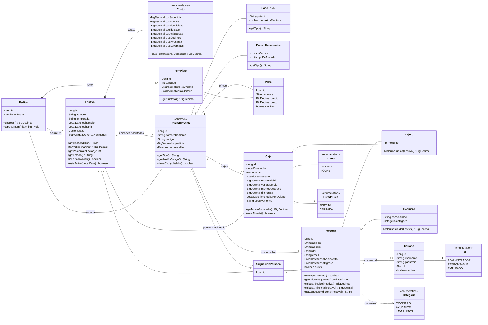

# Diagrama de clases — Gestión de un Festival

Modelo de dominio de Epicentro Gourmet. Se puede visualizar directamente en GitHub (Mermaid) o pegar el
bloque en <https://mermaid.live> para exportarlo como PNG/PDF.

## Notas de modelado

| Decisión | Justificación |
|---|---|
| `Festival` **tiene** un `Costo` embebido (no una tabla aparte) | Evita montos hardcodeados en los métodos: cada festival define sus propios valores y `Costo` es un `@Embeddable` que se guarda en la misma tabla. |
| Herencia `SINGLE_TABLE` en `UnidadDeVenta` | Food Truck y Puesto Desarmable comparten identidad, responsable y superficie; solo difieren en atributos y en la fórmula de canon (`calcularCanon` resuelve con `instanceof`). |
| Herencia `SINGLE_TABLE` en `Persona` | Una `Persona` "a secas" es el **responsable** de una unidad; `Cajero` y `Cocinero` son el **personal** que cobra sueldo. Así el responsable no cotiza como empleado. |
| `AsignacionPersonal` como entidad intermedia | Resuelve el muchos-a-muchos entre personal, festival y unidad: un empleado puede trabajar en distintos festivales y en distintas unidades. |
| `ItemPlato` guarda precio y costo unitarios | Snapshot histórico: si el plato cambia de precio, los pedidos ya registrados y los reportes no se alteran. |
| `Caja` nueva (Hito 2) | Cierre de caja del cajero: guarda el arqueo del turno, las ventas calculadas desde los pedidos y la diferencia declarada. |
| `Plato.activo` y `Persona.activo` | Baja lógica: no se borra el registro, se desactiva; se reactiva con un método específico. |
